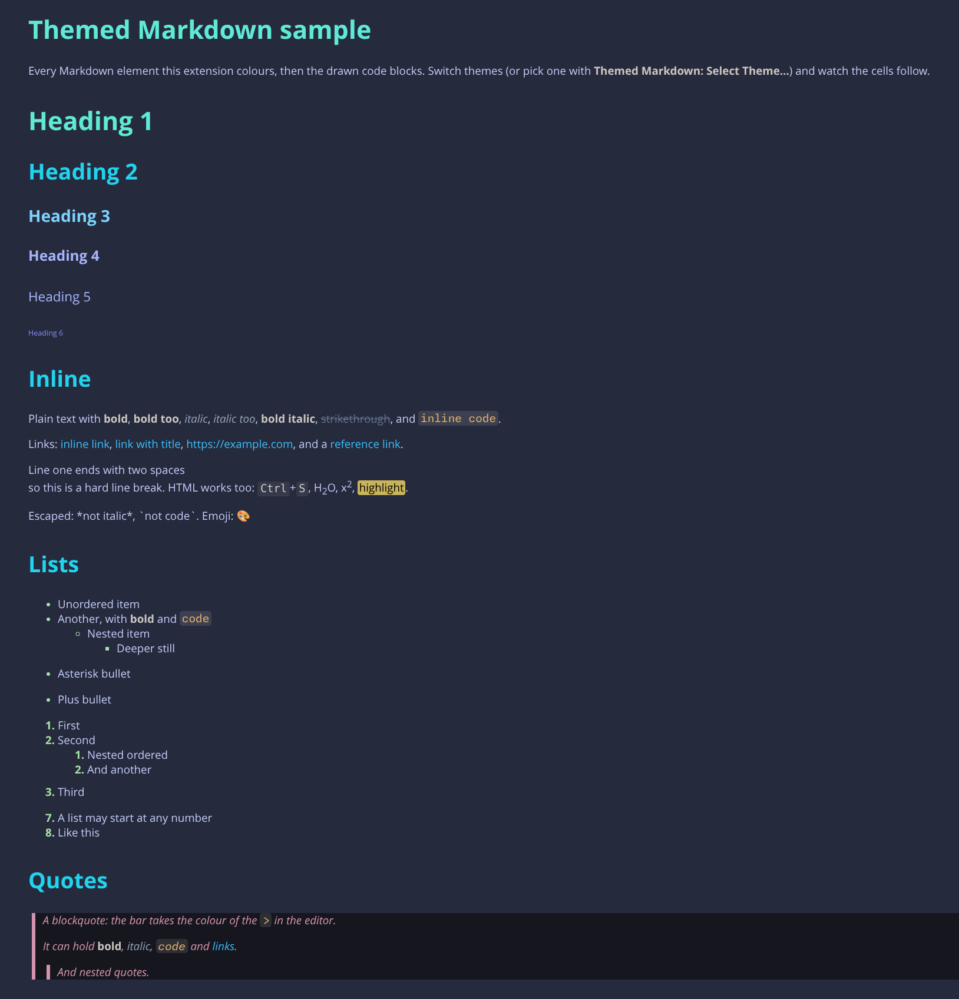
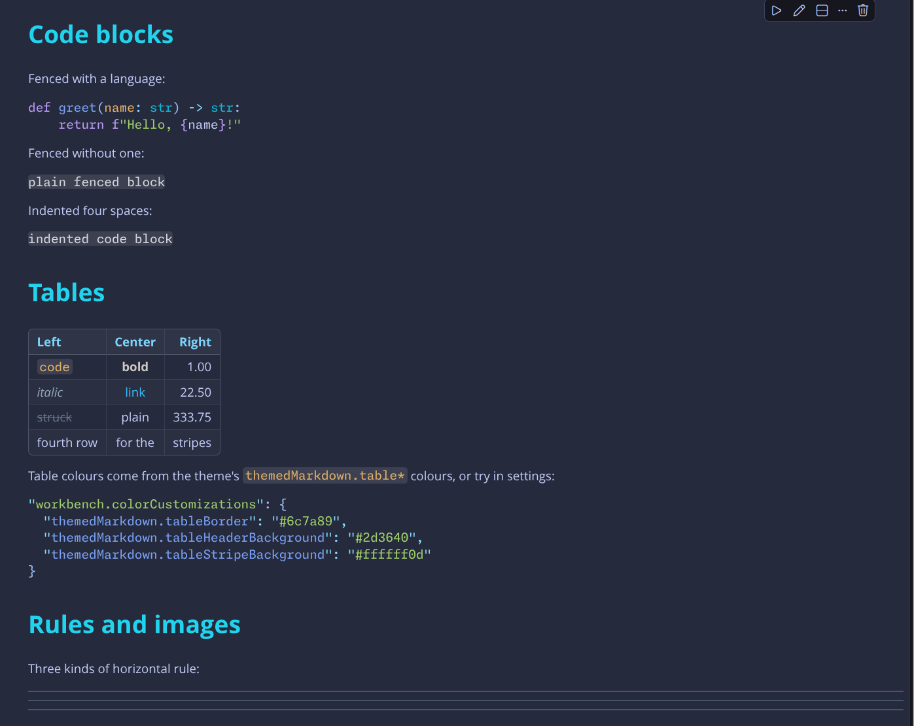

# Midnight Slate

Deep navy background with cool slate text and bright teal, sky and amber accents. A dark VS Code colour theme, made for [rich-struct](https://github.com/wiertmir/rich-struct), where it is one of the built-in themes.

Markdown gets its own colours while editing: each heading level, bold, italic, inline code, links, list bullets and quotes.
With the themed-markdown-notebook-render extension the same colours show in notebook Markdown cells.





## Install

```sh
npm run package                          # builds midnight-slate-theme-0.1.12.vsix
code --install-extension midnight-slate-theme-0.1.12.vsix
```

Then pick **Midnight Slate** with *Preferences: Color Theme*.
